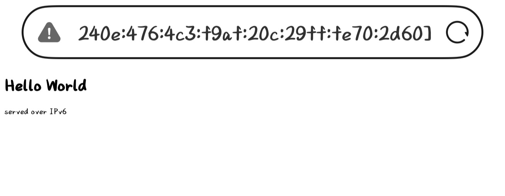

# HARD-1：计算机网络基础

## step 1

### part 1

- ***127.0.0.1***

  - 含义:属于回环网段127.0.0.0/8,整个127/8段里最常用的地址.代表本机的地址,发往这个地址的数据包不经过网卡和线路,直接发往本机.
  - 用途:自检本机协议栈,本机服务测试,访问隔离.
  - 与localhost的关系:localhost是主机名,127.0.0.1是IPv4地址.localhost由hosts文件解析到IPv4地址.

- ***常见特殊网段***
  
  - 私有地址

    - 网段:10.0.0.0/8,172.16.0.0/12,192.168.0.0/16
    - 用途:局域网内部编号,公网不路由,靠NAT上网
  
  - 回环地址

    - 网段:127.0.0.0/8
    - 用途:数据不出网卡,由内核直接送回本机;用于自检协议栈,本机测试服务,访问隔离

  - 链路本地地址

    - 网段:169.254.0.0/16(IPv4),fe80::/10(IPv6)
    - 用途:无DHCP时自动配置,只在同一链路内有效,不被路由器转发

  - 多播地址

    - 网段:224.0.0.0/4,ff00::/8
    - 用途:一对多,只有加入该组的机器接收

  - 广播地址

    - 网段:255.255.255.255,子网广播x.x.x.255
    - 用途:广播域内所有机器接收.用于ARP请求,DHCP Discover

### part 2

查阅资料,整理如下

- OSI七层模型:

| 层号 | OSI 层名 | 主要功能 | 常见协议 | 数据单元 | 典型设备 | 对应 TCP/IP 层 |
| :--: | :-- | :-- | :-- | :--: | :-- | :-- |
| 7 | 应用层（Application） | 直接为用户程序提供服务，处理业务逻辑与数据语义 | HTTP、HTTPS、FTP、SMTP、POP3、IMAP、DNS、DHCP、SSH、Telnet、SNMP | 报文（message） | 网关、应用服务器 | 应用层（Application） |
| 6 | 表示层（Presentation） | 数据格式转换：编码解码、加密解密、压缩解压 | SSL/TLS、JPEG、MPEG、ASCII、UTF-8 | — | — | ↑ 并入应用层 |
| 5 | 会话层（Session） | 建立、管理、终止会话；同步与断点续传 | RPC、NetBIOS、PPTP、SQL 会话 | — | — | ↑ 并入应用层 |
| 4 | 传输层（Transport） | 端到端（进程到进程）通信；分段重组、端口寻址、流量控制、差错控制 | TCP、UDP、SCTP、QUIC | 段（segment，TCP）、数据报（datagram，UDP） | 四层负载均衡器、防火墙 | 传输层（Transport） |
| 3 | 网络层（Network） | 主机到主机通信；逻辑寻址（IP）、路由选择、分片重组 | IP、ICMP、IGMP、ARP、RIP、OSPF、BGP、IPSec | 分组 / 包（packet） | 路由器、三层交换机 | 网际层 / 网络层（Internet） |
| 2 | 数据链路层（Data Link） | 同一链路上相邻节点的可靠传输；MAC 寻址、成帧、差错检测、介质访问控制 | Ethernet、PPP、HDLC、VLAN、STP、ARP | 帧（frame） | 交换机、网桥、网卡 | 网络接口层（Network Interface） |
| 1 | 物理层（Physical） | 在物理介质上传输比特流；定义电气、机械、时序特性 | RJ45、光纤、双绞线、Wi-Fi 物理层、RS-232 | 比特（bit） | 中继器、集线器 Hub、网线、光纤 | ↑ 并入网络接口层 |

- TCP/IP四层模型:

| 层号 | 层名 | 对应 OSI | 核心职责 | 代表协议 |
| :--: | :-- | :-- | :-- | :-- |
| 4 | 应用层（Application） | 第 5、6、7 层 | 面向具体应用的数据交换；OSI 的会话层与表示层功能被合并进来 | HTTP、HTTPS、DNS、DHCP、FTP、SMTP、SSH |
| 3 | 传输层（Transport） | 第 4 层 | 端到端通信，用端口区分进程；TCP 保证可靠有序，UDP 追求低延迟 | TCP、UDP、QUIC |
| 2 | 网际层（Internet） | 第 3 层 | 逻辑寻址与路由，把数据包跨网络送到目标主机 | IP、ICMP、IGMP、ARP、OSPF、BGP |
| 1 | 网络接口层（Network Interface） | 第 1、2 层 | 与硬件打交道：成帧、MAC 寻址、比特传输 | Ethernet、PPP、Wi-Fi、ARP |

### part 3

- ***DNS的作用:*** 把域名翻译成IP.
- ***DNS查询流程***
  
  - 查询时先查本地:浏览器缓存->hosts文件静态映射->操作系统缓存,全不命中则发网络请求;
  - 递归和迭代:递归是客户端->本地DNS,递归解析器承担全部解析工作;迭代是本地DNS->根/TLD/权威服务器,递归解析器承担多轮查询的往返开销
  - 三类域名服务器:

    - 根域名服务器:它持有根区的数据,内容只有所有顶级域的NS记录加上对应的glue A/AAAA记录
    - 顶级域服务器:持有各二级域的NS记录与glue记录
    - 权威域名服务器:它由域名持有者自己配置,持有该区域的完整资源记录集.上面两种服务器的职能都是将查询在目标域的权威域名服务器上继续.
- ***实际操作:*** 以百度官网为例


### part 4

- ***ARP的作用:***

  - 工作原理:
  
    - ARP请求:主机要发包但不知道目标MAC,于是构造ARP请求,以以太网广播帧
    - ARP应答:只有IP匹配的主机回应,以单播帧发回自己的MAC
    - 双方缓存:结果写入各自的ARP缓存表,条目有生存期,避免反复广播

  - 在局域网通信中的地位:ARP位于网络层与链路层之间,是二者唯一的桥梁.

- ***ARP报文结构:***ARP报文固定28字节,封装在以太网帧中.帧头14字节:

  - 硬件类型,协议类型,硬件地址长度,协议地址长度,操作码,发送方MAC,发送方IP,目标MAC,目标IP..字节数分别为2,2,1,1,2,6,4,6,4.

- ***ARP与安全:***

  - 安全隐患:ARP无认证无状态,无条件信任任何ARP应答.可能导致ARP欺骗/ARP投毒,ARP泛洪等
  - 防护手段:ARP无认证的缺陷在协议层面无法修补,因此防护只能在"绑定校验"和"上层加密"两端.比如:静态 RP绑定,ARP防护软件,VLAN隔离/私有VLA等.

- ***按步骤捕获请求:***


- 部分字段:

  - Type ARP(0x0806):以太网帧头里的类型字段;
  - Opcode 1/2:1 = 请求,2 = 应答;
  - Trailer: 0000...:不是ARP内容,是填充字节;
  - 标准ARP请求目的MAC应该广播ff:ff:ff:ff:ff:ff,Target MAC全0,这两条单播94:97:4f:22:bb:29,说明发送方已知对方MAC.

### part 5

- ***为什么需要IPv6:*** IPv4的地址是32位,理论上限2^32≈43亿.而IANA在2011年2月就已把最后一批地址块分完,各地区注册管理机构随后陆续耗尽.IPv4靠NAT续了十几年命,但NAT付出了沉重代价:破坏了端到端可达性,让P2P与IP电话变得困难,增加状态维护开销,也让"哪台设备在通信"变得不可追溯.IPv6将地址空间提高到128位,几乎取之不尽.报头大幅简化,取消首部校验和,地址自动配置,不再需要NAT,地址书写更灵活.
- ***获取我的IPv6地址:*** 使用ipconfig命令.


- 实验:Nginx
  - 实验环境:Ubuntu虚拟机


手机浏览器进行访问测试:



### part 6

(1).为什么重庆服延迟高于天津服:

- 网口方面,宿舍网口决定了出口路径.欣五网口上连楼宇交换机>校园网核心>教育网出口,流量不看地理距离,到天津可能反而命中了教育网与目标运营商的直连互联点.
- 路由器方面,同型号的两个路由器信道冲突,可能形成同信道.也可能IPv6协议不完整,实际IPv6流量被绕回隧道转发.

(2).为什么切热点再切回WiFi,延迟下降:切换过程中,客户端保留了在热点下拿到的IPv4路径,没有重走校园网的劣质路由.

- 体现的协议功能:

  - DNS的多级缓存+TTL生效,缓存了热点的解析结果.
  - NAT,会话项表保持,五元组匹配后流量沿用旧路径.
  - DHCP/SLAAC:切换网络时重新获取IP,默认网关与DNS配置.
  - ARP/NDP:重新解析新网关的硬件地址.

(3).为什么语音卡顿但游戏流畅:

- 可能语音与游戏走不同路径,对局服务器在近处,语音服务器需要绕行.
- 上行拥塞导致语音上行连续码丢包.
- 路由器QoS把语音降优先级.

(4).使用加速器延迟变为20ms:

- 可以排除的原因:网卡网线路由器硬件问题,带宽不足或限速,游戏服务器本身问题,DNS解析错误,ARP风暴.
- 可能的原因:路由绕行或路由次优,出口拥塞,IPv6路径质量问题等.

## step 2

- 由于笔试即将截止,没有充分时间进行研究学习.通过紧跟教程制作了简洁的版本,在windows系统上实现了客户端和服务器的单线程通信(使用的函数都在文档中有记载):


- 以下为客户端代码:

```c
#include<stdio.h>
#include<WinSock2.h>
#pragma comment(lib,"ws2_32.lib")

int main() {

WSADATA wsaData;
	WSAStartup(MAKEWORD(2, 2), &wsaData);


	//创建socket套接字
	SOCKET client_socket = socket(AF_INET, SOCK_STREAM, 0);
	if (INVALID_SOCKET == client_socket) {
		printf("creat socket failed ! \n");
		return -1;
	}

	//连接服务器
	struct sockaddr_in target;
	target.sin_family = AF_INET;
	target.sin_port = htons(8080);
	target.sin_addr.s_addr = inet_addr("127.0.0.1");

	if (-1 == connect(client_socket, (struct sockaddr*)&target, sizeof(target))) {
		printf("connect server failed ! \n");
		closesocket(client_socket);
		return -1;
	}

	//开始通讯
	while (1) {
		char sbuffer[1024] = { 0 };
		scanf("%s", sbuffer);

		send(client_socket, sbuffer, strlen(sbuffer), 0);
		char rebuffer[1024] = { 0 };
		int ret = recv(client_socket, rebuffer, 1024, 0);

		if (ret <= 0) break;
		printf("%s\n", rebuffer);

	}
		//关闭连接
		closesocket(client_socket);
	

	return 0;
}
```

- 以下为服务器代码

```c
#define _WINSOCK_DEPRECATED_NO_WARNINGS
#define _CRT_SECURE_NO_WARNINGS
#include<stdio.h>
#include<string.h>
#include<winsock2.h>
#pragma comment(lib,"ws2_32.lib")

int main() {

    //Windows上使用网络功能,开始网络权限
    WSADATA wsaData;
    WSAStartup(MAKEWORD(2, 2), &wsaData);

    //创建socket套接字
    SOCKET listen_socket = socket(AF_INET, SOCK_STREAM, 0);
    if (INVALID_SOCKET == listen_socket) {
        printf("create listen socket failed ! errcode: %d\n",WSAGetLastError());
        return -1;
    }

    //给socket绑定端口号
    struct sockaddr_in local = { 0 };
    local.sin_family = AF_INET;
    local.sin_port = htons(8080); 
    local.sin_addr.s_addr = inet_addr("127.0.0.1");

    if (-1 == bind(listen_socket, (struct sockaddr*)&local, sizeof(local))) {
        printf("bind socket failed ! errcode: %d\n", WSAGetLastError());
        return -1;
    }

    //给socket开启监听属性
    if (-1 == listen(listen_socket, 10)) {
        printf("start listen failed ! errcode: %d\n", WSAGetLastError());
        return -1;
    }

    //等待客户端连接
    while (1)
    {
        SOCKET client_socket = accept(listen_socket, NULL, NULL);
        if (INVALID_SOCKET == client_socket)
            continue;

        //开始通讯(B/S)
        while (1) {

    char buffer[1024] = { 0 };
    int ret = recv(client_socket, buffer, 1024, 0);
    if (ret <= 0) break;

    printf("%s\n", buffer);

    send(client_socket, buffer, strlen(buffer), 0);
}
return 0;
}
```

- 经过分析,只能实现单线程的原因是服务器代码 **//开始通讯** 部分的while循环 -- 要实现既跟socket建立通讯,又不能断开连接,所以需要使用一个while循环进行维护.直到客户端主动退出,有break退出循环.
- 得出的解决方案是,在连接一旦完成之后进入线程.找到一个函数CreateTreade.
- 核对某示例源代码后,修改的服务器已经可以实现同时接受多个客户端的通信.在最后的时间里,对项目的理解依然不深且项目本身较为粗糙.


- 最终版的整个文件储存在code文件夹内,使用Visual Studio进行编写.

>下面还是粘贴一遍最终的代码:

- 服务器:

```c
#define _WINSOCK_DEPRECATED_NO_WARNINGS
#define _CRT_SECURE_NO_WARNINGS
#include<stdio.h>
#include<string.h>
#include<winsock2.h>
#pragma comment(lib,"ws2_32.lib")

DWORD WINAPI thread_func(LPVOID lpThreadParameter) {
    SOCKET client_socket = *(SOCKET*)lpThreadParameter;
    free(lpThreadParameter);

    while (1) {

        char buffer[1024] = { 0 };
        int ret = recv(client_socket, buffer, 1024, 0);
        if (ret <= 0) break;

        printf("%s\n", buffer);

        send(client_socket, buffer, (int)strlen(buffer), 0);
        
    }
    return 0;
}

int main() {

    //Windows上使用网络功能,开始网络权限
    WSADATA wsaData;
    WSAStartup(MAKEWORD(2, 2), &wsaData);

    //创建socket套接字
    SOCKET listen_socket = socket(AF_INET, SOCK_STREAM, 0);
    if (INVALID_SOCKET == listen_socket) {
        printf("create listen socket failed ! errcode: %d\n",WSAGetLastError());
        return -1;
    }

    //给socket绑定端口号
    struct sockaddr_in local = { 0 };
    local.sin_family = AF_INET;
    local.sin_port = htons(8080); 
    local.sin_addr.s_addr = inet_addr("127.0.0.1");

    if (-1 == bind(listen_socket, (struct sockaddr*)&local, sizeof(local))) {
        printf("bind socket failed ! errcode: %d\n", WSAGetLastError());
        return -1;
    }

    //给socket开启监听属性
    if (-1 == listen(listen_socket, 10)) {
        printf("start listen failed ! errcode: %d\n", WSAGetLastError());
        return -1;
    }

    //等待客户端连接
    while (1)
    {
        SOCKET client_socket = accept(listen_socket, NULL, NULL);
        if (INVALID_SOCKET == client_socket)
            continue;

        SOCKET* sockfd = (SOCKET*)malloc(sizeof(SOCKET));
        *sockfd = client_socket;

        //进入线程
        CreateThread(NULL, 0, thread_func, sockfd, 0, NULL);
        //开始通讯
    }
    return 0;
}
```

- 客户端:

```c
#include<stdio.h>
#include<WinSock2.h>
#pragma comment(lib,"ws2_32.lib")

int main() {

	WSADATA wsaData;
	WSAStartup(MAKEWORD(2, 2), &wsaData);


	//创建socket套接字
	SOCKET client_socket = socket(AF_INET, SOCK_STREAM, 0);
	if (INVALID_SOCKET == client_socket) {
		printf("creat socket failed ! \n");
		return -1;
	}

	//连接服务器
	struct sockaddr_in target;
	target.sin_family = AF_INET;
	target.sin_port = htons(8080);
	target.sin_addr.s_addr = inet_addr("127.0.0.1");

	if (-1 == connect(client_socket, (struct sockaddr*)&target, sizeof(target))) {
		printf("connect server failed ! \n");
		closesocket(client_socket);
		return -1;
	}

	//开始通讯
	while (1) {
		char sbuffer[1024] = { 0 };
		scanf("%s", sbuffer);

		send(client_socket, sbuffer, strlen(sbuffer), 0);
		char rebuffer[1024] = { 0 };
		int ret = recv(client_socket, rebuffer, 1024, 0);

		if (ret <= 0) break;
		printf("%s\n", rebuffer);

	}
		//关闭连接
		closesocket(client_socket);
	

	return 0;
}
```
